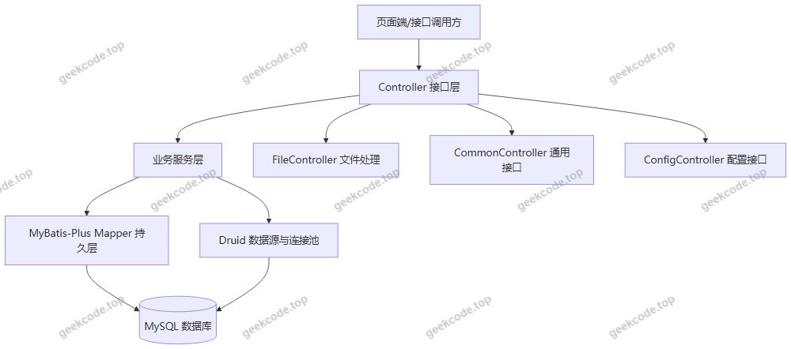
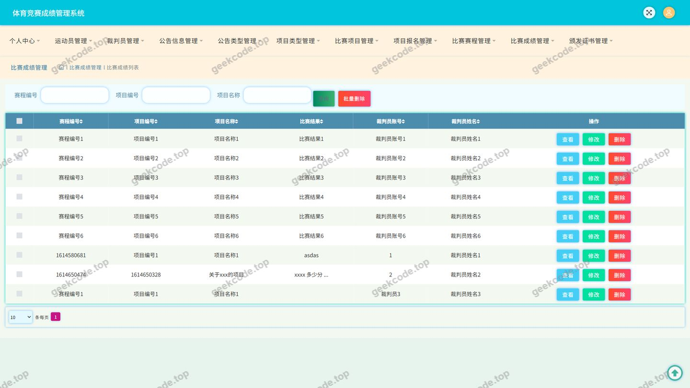
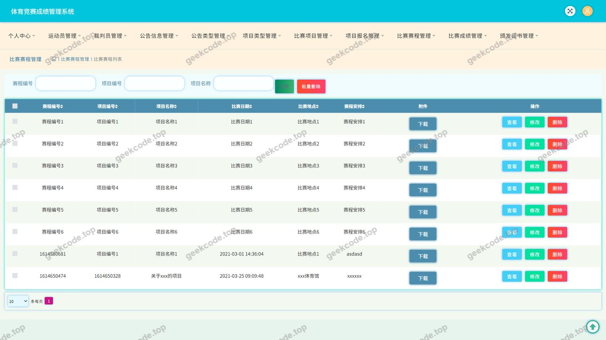
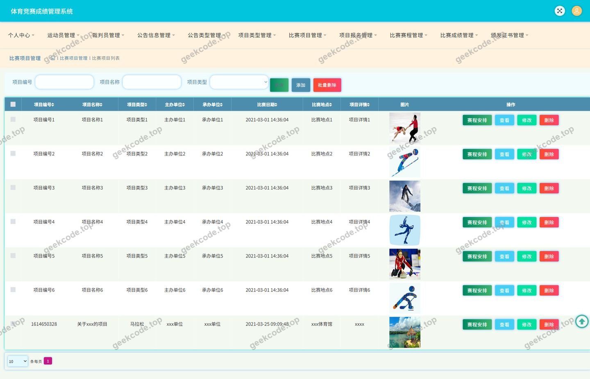
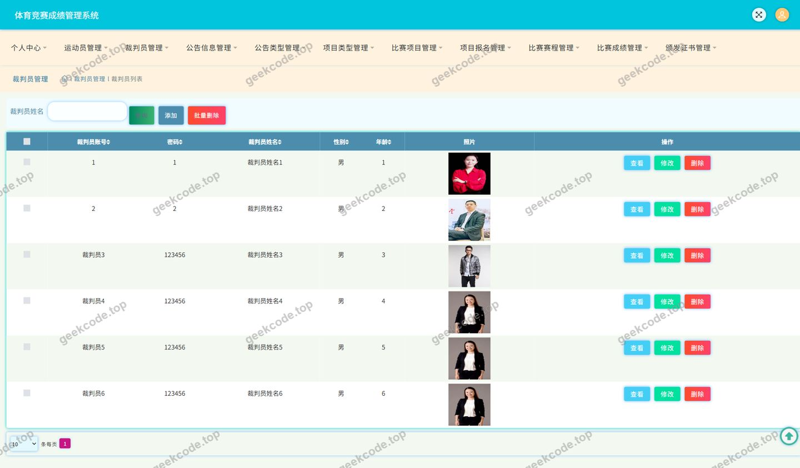
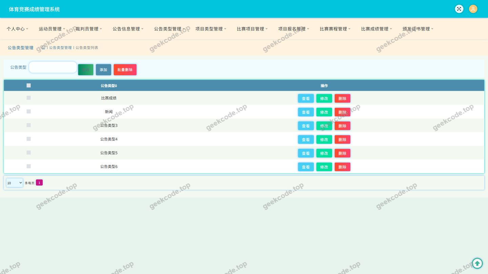
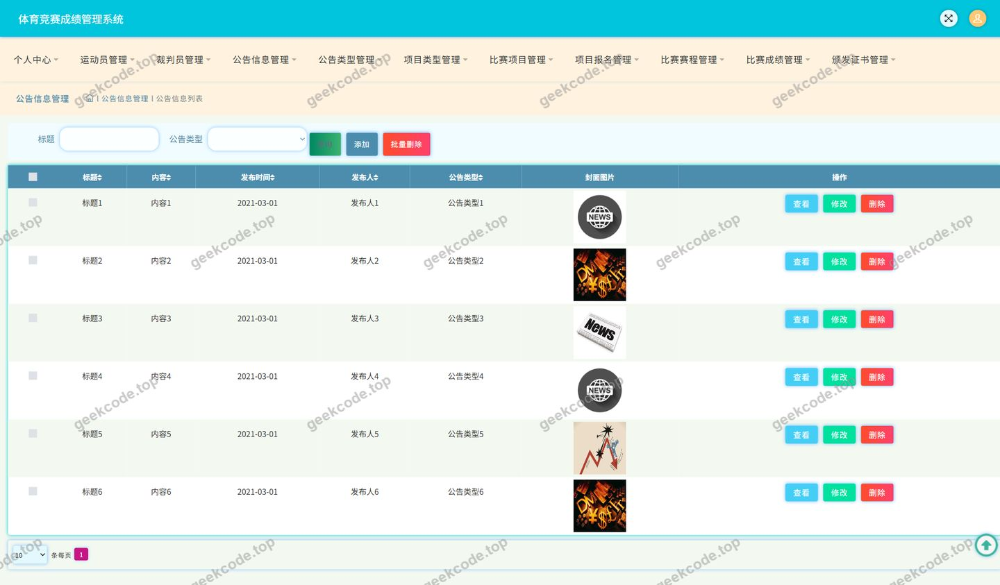
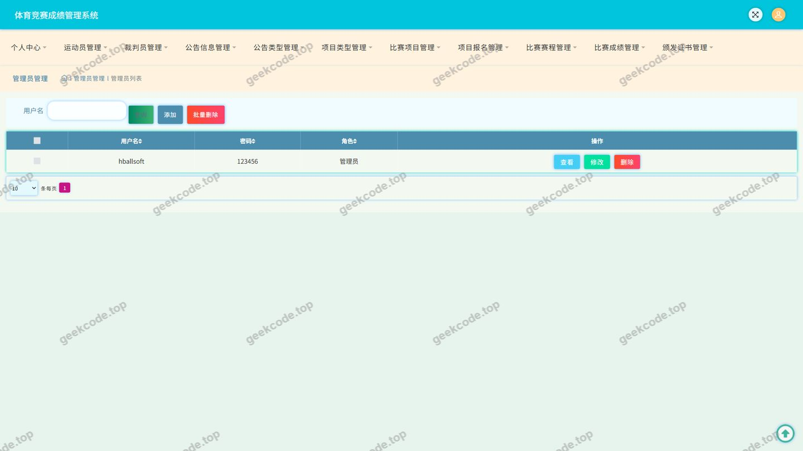
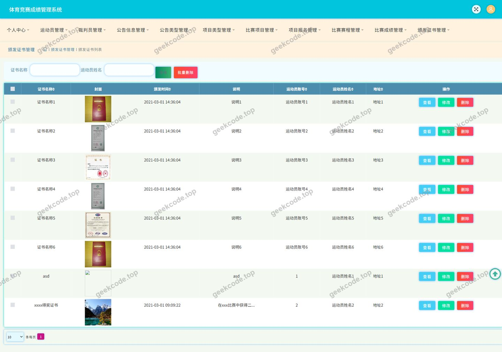

# java项目体育竞赛成绩管理系统java毕业设计

> 🎓 **计算机毕业设计 · java项目体育竞赛成绩管理系统java毕业设计**
>
> 本仓库只放**项目介绍 + 运行截图**（截图是站点带水印的原图，存在仓库 `images/` 里）。
>
> 👉 **完整可运行源码 / 数据库脚本 / 部署文档：[点我获取](https://geekcode.top/archives/java%E9%A1%B9%E7%9B%AE%E4%BD%93%E8%82%B2%E7%AB%9E%E8%B5%9B%E6%88%90%E7%BB%A9%E7%AE%A1%E7%90%86%E7%B3%BB%E7%BB%9Fjava%E6%AF%95%E4%B8%9A%E8%AE%BE%E8%AE%A1?utm_source=github)**
>
> 💬 咨询微信：**ir9372**　|　🌐 更多项目：[极客代码 geekcode.top](https://geekcode.top/?utm_source=github)
>
> 📌 项目详情页：<https://geekcode.top/archives/java%E9%A1%B9%E7%9B%AE%E4%BD%93%E8%82%B2%E7%AB%9E%E8%B5%9B%E6%88%90%E7%BB%A9%E7%AE%A1%E7%90%86%E7%B3%BB%E7%BB%9Fjava%E6%AF%95%E4%B8%9A%E8%AE%BE%E8%AE%A1?utm_source=github>

<table><td width="230" align="center"> <b>扫码加微信 ir9372</b></td><td valign="middle">📦 源码 = 项目介绍 + 全部运行截图 + 数据库 + 部署文档 👉 点上方任意截图，直接跳到 <b>极客代码 geekcode.top</b> 详情页</td></table>

---

<h1>java项目_体育竞赛成绩管理系统_java毕业设计</h1>
<h2>项目概述</h2>

本项目为体育竞赛成绩管理系统，是一套面向体育赛事组织场景的后端接口服务系统（pure-api）。系统围绕&quot;比赛项目—项目报名—比赛赛程—比赛成绩—证书颁发&quot;的主线业务展开，同时提供裁判员管理、公告类型与公告信息管理、用户管理、文件上传与系统配置等支撑能力。

核心功能包括：比赛项目维护、运动员报名信息管理、赛程编排与查询、成绩录入与统计、获奖证书颁发记录管理，以及公告发布和基础数据配置。系统通过 BanfazhengshuController、BisaichengjiController、BisaisaichengController、BisaixiangmuController、XiangmubaomingController 等接口对外提供数据服务，配合截图中的登录、运动员、比赛成绩、比赛赛程、比赛项目、裁判员、公告类型、公告信息、用户等操作页面使用。

适用人群为学校运动会、院系体育赛事、社会体育竞赛的组织者与成绩管理人员。技术架构上采用 Spring 生态（spring-web/spring-webmvc、spring-tx、spring-aop）构建 Web 层与事务管理，持久层使用 MyBatis-Plus，数据源采用 Druid 连接池，并以 JUnit 支撑单元测试。

<h2>技术架构</h2>
<h3>整体架构</h3>

系统为纯后端接口架构，不包含独立前台工程与后台路由配置，业务能力以 Controller 接口形式对外暴露，由外部页面（截图中所示的登录、运动员、比赛成绩等页面）调用。

<h3>分层说明</h3>
<ul>
<li><strong>接口层</strong>：由 12 个 Controller 组成，按业务实体划分，包括比赛项目、项目报名、比赛赛程、比赛成绩、颁发证书、裁判员、公告类型、公告信息、用户，以及通用接口、配置接口、文件接口。</li>
<li><strong>业务与事务层</strong>：依赖中包含 spring-tx、spring-aop，用于声明式事务管理与横切逻辑处理；spring-context、spring-context-support 提供容器与上下文支持。</li>
<li><strong>持久层</strong>：采用 MyBatis-Plus，借助其通用 CRUD 与条件构造能力减少样板代码，实体与数据库表通过注解映射。</li>
<li><strong>数据源层</strong>：采用 Druid 连接池，负责连接复用、SQL 执行监控与连接池参数管理。</li>
<li><strong>测试</strong>：引入 JUnit 支撑单元测试。</li>
</ul>
<h3>数据库设计要点</h3>
<ul>
<li>数据库采用 MySQL（依据 Druid + MyBatis-Plus 的常规组合，具体版本与库名根据现有信息无法确定）。</li>
<li>数据模型围绕赛事业务实体组织，主要实体与 Controller 一一对应：比赛项目、项目报名、比赛赛程、比赛成绩、颁发证书、裁判员、公告类型、公告信息、用户。</li>
<li>实体间存在业务关联：报名记录关联比赛项目与参赛人员，赛程关联比赛项目，成绩关联赛程/项目，证书关联成绩或获奖对象，公告信息关联公告类型。具体外键与字段设计根据现有信息无法确定。</li>
</ul>
<h3>技术选型理由</h3>
<ul>
<li><strong>MyBatis-Plus</strong>：在 MyBatis 基础上提供通用 Mapper 与条件构造器，适合以单表增删改查为主的赛事管理业务，可显著降低 DAO 层重复代码量，同时保留手写 SQL 的灵活性。</li>
<li><strong>Druid</strong>：提供成熟的连接池管理与 SQL 监控能力，便于在并发访问赛事成绩、报名数据时观察慢 SQL 与连接使用情况。</li>
<li><strong>Spring MVC + spring-tx</strong>：接口层与事务边界清晰，适合多表写入场景（如成绩录入与证书颁发）保证数据一致性。</li>
<li><strong>JUnit</strong>：便于对业务接口与核心逻辑编写自动化测试。</li>
</ul>
<h2>功能模块</h2>

本项目为纯接口后端，无独立前台用户端工程，功能以管理端业务接口的形式提供，对应截图中的九类操作页面。

<h3>管理端功能模块</h3>
<table>
<thead>
<tr>
<th>模块</th>
<th>对应 Controller</th>
<th>功能说明</th>
</tr>
</thead>
<tbody><tr>
<td>登录</td>
<td>—</td>
<td>提供系统登录入口页面，作为进入各管理页面的前置操作</td>
</tr>
<tr>
<td>用户管理</td>
<td>UserController</td>
<td>维护系统用户信息，对应&quot;用户&quot;页面</td>
</tr>
<tr>
<td>运动员管理</td>
<td>—</td>
<td>维护参赛运动员信息，对应&quot;运动员&quot;页面</td>
</tr>
<tr>
<td>比赛项目管理</td>
<td>BisaixiangmuController</td>
<td>维护比赛项目的基础信息（项目设置、项目查询等），对应&quot;比赛项目&quot;页面</td>
</tr>
<tr>
<td>项目报名管理</td>
<td>XiangmubaomingController</td>
<td>管理运动员/参赛单位对比赛项目的报名记录</td>
</tr>
<tr>
<td>比赛赛程管理</td>
<td>BisaisaichengController</td>
<td>维护各比赛项目的赛程安排，对应&quot;比赛赛程&quot;页面</td>
</tr>
<tr>
<td>比赛成绩管理</td>
<td>BisaichengjiController</td>
<td>录入、修改与查询比赛成绩，对应&quot;比赛成绩&quot;页面</td>
</tr>
<tr>
<td>颁发证书管理</td>
<td>BanfazhengshuController</td>
<td>记录与管理获奖证书的颁发信息</td>
</tr>
<tr>
<td>裁判员管理</td>
<td>CaipanyuanController</td>
<td>维护裁判员基础信息与执裁相关信息，对应&quot;裁判员&quot;页面</td>
</tr>
<tr>
<td>公告类型管理</td>
<td>GonggaoleixingController</td>
<td>维护公告分类字典，对应&quot;公告类型&quot;页面</td>
</tr>
<tr>
<td>公告信息管理</td>
<td>GonggaoxinxiController</td>
<td>发布、修改与查询公告内容，对应&quot;公告信息&quot;页面</td>
</tr>
<tr>
<td>通用接口</td>
<td>CommonController</td>
<td>提供跨模块的公共数据与通用操作接口</td>
</tr>
<tr>
<td>配置管理</td>
<td>ConfigController</td>
<td>提供系统参数/配置项的读取与维护接口</td>
</tr>
<tr>
<td>文件管理</td>
<td>FileController</td>
<td>提供文件上传、下载等文件处理能力，供证书、公告等业务复用</td>
</tr>
</tbody></table>
<h2>用户角色与权限</h2>

根据现有代码上下文，系统通过登录页面进入管理界面，用户信息由 UserController 统一管理；裁判员、运动员在系统中作为业务数据对象被维护（分别对应裁判员管理模块与运动员页面）。现有信息中未提供角色权限配置表或权限拦截规则，因此：

<h3>系统登录用户（管理端用户）</h3>

登录后可访问的功能模块包括：

<ul>
<li>运动员信息管理</li>
<li>比赛项目管理</li>
<li>项目报名管理</li>
<li>比赛赛程管理</li>
<li>比赛成绩管理</li>
<li>颁发证书管理</li>
<li>裁判员管理</li>
<li>公告类型管理</li>
<li>公告信息管理</li>
<li>用户管理</li>
<li>文件上传与下载</li>
<li>系统配置读取与维护</li>
</ul>
<h3>裁判员</h3>

裁判员信息由 CaipanyuanController 统一维护，属于被管理的业务实体。裁判员是否具备独立登录账号及其可访问的功能范围，根据现有信息无法确定。

<h3>运动员</h3>

运动员信息通过&quot;运动员&quot;页面维护，属于被管理的业务实体，并作为项目报名与比赛成绩的关联对象。运动员是否具备独立登录账号及其可访问的功能范围，根据现有信息无法确定。

多角色（如管理员、教练、普通用户）的细分权限模型在现有代码上下文中未体现，根据现有信息无法确定。

<h2>项目特色与创新点</h2>
<ol>
<li><strong>赛事业务闭环设计</strong>：以&quot;比赛项目 → 项目报名 → 比赛赛程 → 比赛成绩 → 颁发证书&quot;为主链条，将分散的赛事管理环节串联为可追溯的数据流，避免成绩与证书信息脱节。</li>
<li><strong>模块边界清晰</strong>：按业务实体拆分 Controller，公告、裁判员、用户等支撑模块与核心竞赛模块解耦，便于后续按赛事规模扩展。</li>
<li><strong>通用能力复用</strong>：通过 CommonController、ConfigController、FileController 抽取公共数据、配置项与文件处理能力，减少各业务模块的重复实现，证书与公告等模块可共享文件服务。</li>
<li><strong>持久层效率优化</strong>：采用 MyBatis-Plus 的通用 CRUD 与条件构造能力，使以单表维护为主的赛程、项目、公告类业务开发更为轻量，同时保留复杂查询的扩展空间。</li>
<li><strong>可观测的数据访问</strong>：引入 Druid 连接池，便于对成绩查询、报名统计等高频访问进行 SQL 监控与连接池调优。</li>
<li><strong>接口化交付</strong>：系统以纯 API 形式提供能力，页面端与业务逻辑分离，便于后续接入 Web 管理端或移动端。</li>
</ol>
<h2>部署环境</h2>
<table>
<thead>
<tr>
<th>类别</th>
<th>要求</th>
</tr>
</thead>
<tbody><tr>
<td>运行环境</td>
<td>JDK（具体版本根据现有信息无法确定，需与项目编译级别一致）</td>
</tr>
<tr>
<td>Web 容器</td>
<td>支持 Spring MVC 的 Servlet 容器（内嵌容器或独立 Tomcat，具体根据现有信息无法确定）</td>
</tr>
<tr>
<td>数据库</td>
<td>MySQL，需提前创建数据库并导入初始化脚本</td>
</tr>
<tr>
<td>连接池</td>
<td>Druid（由项目依赖引入，需在配置文件中配置数据源地址、账号、密码及连接池参数）</td>
</tr>
<tr>
<td>依赖管理</td>
<td>Maven（依据依赖清单组织 junit、spring-core、spring-context、spring-context-support、spring-tx、spring-aop、spring-beans、spring-jdbc、spring-web、spring-webmvc、MyBatis-Plus、Druid）</td>
</tr>
<tr>
<td>持久层</td>
<td>MyBatis-Plus，需配置实体扫描与 Mapper 扫描路径</td>
</tr>
<tr>
<td>测试</td>
<td>JUnit</td>
</tr>
<tr>
<td>开发工具</td>
<td>IntelliJ IDEA 等 Java IDE</td>
</tr>
<tr>
<td>前端环境</td>
<td>项目为纯接口后端，无独立前台工程，不需要 Node.js 构建环境；页面端通过接口地址访问后端服务</td>
</tr>
</tbody></table>

启动前需完成的事项：确认数据库服务可用并完成建库建表、在配置文件中填写正确的数据源连接信息、确认文件上传目录（FileController 相关）具备读写权限、按需调整服务端口后启动应用，通过登录页面完成登录再进入各业务管理页面。

<h2>五、技术特性</h2>
<ul>
<li>使用 MyBatis-Plus 简化数据访问层开发</li>
</ul>
<h2>六、功能模块截图</h2>
<h3>后台管理端</h3>
<h4>页面-比赛成绩</h4>

<h4>页面-比赛赛程</h4>

<h4>页面-比赛项目</h4>

<h4>页面-裁判员</h4>

<h4>页面-登录</h4>

<h4>页面-公告类型</h4>

<h4>页面-公告信息</h4>

<h4>页面-用户</h4>

<h4>页面-运动员</h4>

---

## 获取完整源码

| 项目 | 说明 |
| --- | --- |
| 项目名 | java项目体育竞赛成绩管理系统java毕业设计 |
| 运行截图 | 本文 10 张（站点带水印原图，仓库 `images/` 目录） |
| 完整源码 | [https://geekcode.top/archives/java%E9%A1%B9%E7%9B%AE%E4%BD%93%E8%82%B2%E7%AB%9E%E8%B5%9B%E6%88%90%E7%BB%A9%E7%AE%A1%E7%90%86%E7%B3%BB%E7%BB%9Fjava%E6%AF%95%E4%B8%9A%E8%AE%BE%E8%AE%A1?utm_source=github](https://geekcode.top/archives/java%E9%A1%B9%E7%9B%AE%E4%BD%93%E8%82%B2%E7%AB%9E%E8%B5%9B%E6%88%90%E7%BB%A9%E7%AE%A1%E7%90%86%E7%B3%BB%E7%BB%9Fjava%E6%AF%95%E4%B8%9A%E8%AE%BE%E8%AE%A1?utm_source=github) |
| 咨询微信 | **ir9372**（备注：jingpin-yuanma） |
| 更多项目 | [极客代码 geekcode.top](https://geekcode.top/?utm_source=github) |

> 需要源码、部署、改配置、跑不起来等问题，加微信 ir9372 沟通，说明项目名即可。
